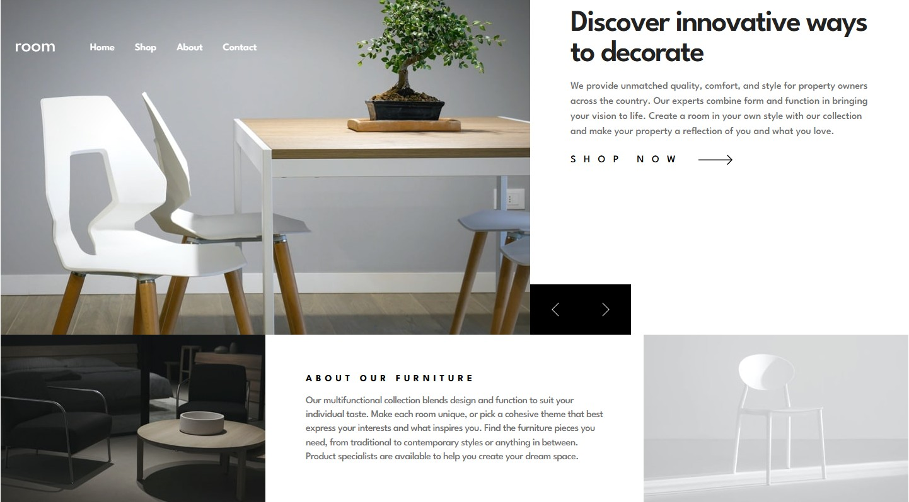

# Frontend Mentor - Room homepage solution

This is a solution to the Room homepage challenge on Frontend Mentor. It presents a responsive furniture homepage with a looping image slider, synchronized product descriptions, and a collapsible mobile navigation menu.

## Table of contents

- Overview
  - The challenge
  - Layout
  - Screenshot
  - Links
- My process
  - Built with
  - What I learned
  - Continued development
  - AI Collaboration
- Author
- Acknowledgments

## Overview

### The challenge

Users should be able to:

- View a responsive layout across mobile, tablet, and desktop screens.
- See hover and keyboard focus feedback on interactive elements.
- Navigate the hero slider with the previous and next buttons or the slider's focused keyboard controls.
- Open and close the mobile menu, dismiss it with Escape, and navigate to existing sections after the menu closes.

Contact and Shop now intentionally remain placeholders. Contact has no matching section, and Shop now has no shopping action attached.

### Layout

The mobile layout stacks the hero, product description, and About section. Tablet styles start at the 768px breakpoint definition; desktop styles start at 1024px. The desktop main container has a maximum width of 1440px and uses twelve equal Grid columns: seven for the hero image and five for the product description.

The custom slider controls sit at the bottom right of the image on mobile and tablet. On desktop, they move to the bottom left of the product description's Grid area.

### Screenshot



### Links

- Solution URL: [Repository](https://github.com/jonghwascript/room-homepage)
- Live Site URL: [Live site](https://jonghwascript.github.io/room-homepage/)

## My process

### Built with

- Semantic HTML5 landmarks and reusable HTML partials
- Responsive images with picture and source elements
- SCSS modules, CSS custom properties, and logical sizing properties
- CSS Grid and Flexbox
- Mobile-first styling and fluid typography with clamp()
- Vanilla JavaScript modules
- Splide 4.1.4 for the looping image slider
- Web Animations API for product description transitions
- League Spartan typography

### What I learned

The following notes summarize the HTML, CSS, and JavaScript implementation decisions recorded during development.

#### HTML: component boundaries and accessible names

The page assembles separate header, slider, slider-control, Shop, About, and footer partials. The header partial is named head.html, but contains the visible header rather than the document head.

The document declares English as its language and includes a page title, a main landmark, and a skip link targeting the main element. The Home destination is the body element's home ID. The CSS-mask logo has an image role and the accessible name room. Menu and slider buttons have accessible names, and slider-control icons are hidden from assistive technology.

The image frame belongs on the picture element so the direct-child selector reaches its img element:

```html
<picture class="splide__picture l-frame">
  <source
    srcset="./images/desktop-image-hero-1.jpg"
    media="(min-width: 48em)"
  />
  
</picture>
```

Selecting a different image source does not automatically change the CSS frame ratio. These are separate responsive decisions.

#### CSS: Grid placement and content growth

A named Grid area belongs to its own Grid container. Moving the slider controls into the main container as direct children lets them share the hero area on smaller screens and the Shop area on desktop.

The desktop layout allows rows to grow with their content:

```css
grid-template-columns: repeat(12, minmax(0, 1fr));
grid-template-rows: minmax(534px, auto) minmax(266px, auto);
```

Grid children use min-inline-size: 0 to avoid their automatic minimum width forcing overflow. Border-box sizing, flexible image widths, wrapping, and relative spacing help accommodate enlarged text. Extra bottom padding in the desktop Shop section reserves room for the overlaid controls.

The fixed desktop header also accounts for the centered main container's outer margin, keeping its left edge 64px inside that container on wide screens.

#### CSS: image ratios and logical dimensions

The shared frame uses custom properties for its aspect ratio. The hero uses 376 / 360 by default and 768 / 400 on tablet, where max-block-size limits the height to 400px. On desktop, block-size: 100%, max-block-size: none, and aspect-ratio: auto let the frame fill the Grid row.

A maximum block size caps the frame; a percentage block size attempts to fill its containing block. They serve different purposes and cannot be substituted without checking the parent's sizing.

Images fill the frame with object-fit: cover, so cropping varies with the frame dimensions. A transparent radial-gradient overlay darkens the edges without covering the center, and pointer-events: none prevents it from intercepting input.

The Shop SVG uses preserveAspectRatio="none". Its current CSS width is 54px and its height is auto; this should not be described as a fixed 12px-high rendering.

#### CSS: responsive spacing and interaction states

The Shop now label grows into the available mobile space, placing the arrow at the far end. At the tablet breakpoint, its flex-grow changes from 1 to 0 with a 0.4s ease transition, leaving a 1.5rem gap. Explicit text-align: start keeps the label aligned to the left in this English page while its box grows.

```scss
> span {
  min-inline-size: 0;
  text-align: start;
  flex: 1 1 auto;
  transition: flex-grow 0.4s ease;

  @include mq('tablet') {
    flex-grow: 0;
  }

  @media (prefers-reduced-motion: reduce) {
    transition: none;
  }
}
```

Hover and focus-visible share visual feedback. Mobile menu links use text underlines; desktop links use a short pseudo-element underline that expands from its center over 0.2s. Reduced-motion rules disable that transition. Focus outlines provide an additional keyboard indicator.

Product and About descriptions use #707070 on white, approximately 4.95:1 contrast. This does not establish contrast compliance for other states: the current Shop now hover and focus color is the separate #A0A0A0 palette value.

#### JavaScript: menu state and deferred navigation

The menu initializer connects controls through data attributes. Opening the panel updates aria-expanded, makes background elements inert, and focuses the close button without scrolling. Closing removes only the inert state introduced by the menu and normally restores focus to the opening button. Escape closes the panel, and crossing the desktop breakpoint resets the mobile state.

For a valid same-page section destination, navigation waits for the panel's transform transition to finish. A fallback timer uses computed transition durations and delays if transitionend does not fire. The destination receives focus with preventScroll before scrollIntoView handles movement. Reduced motion skips the waiting animation and smooth scrolling. Missing destinations and links to other pages retain native navigation behavior.

The header's scroll handler uses requestAnimationFrame to schedule updates. Beyond 100px of scrolling it hides the header only when the menu is closed and focus is outside the header, avoiding hidden menu controls while the background remains inert.

#### JavaScript: synchronized slider descriptions

Splide handles the looping image movement over 500ms. Its move event starts a separate Web Animations API sequence for the matching description: a 120ms fade-out, followed by a 300ms fade-in with an 8px upward movement.

The initial mounted event selects the description immediately. Event handlers are registered before mount so that initial event is received. The u-hidden class is applied after fade-out, since display: none would hide the animation immediately.

Rapid navigation cancels active animations. A transition counter prevents an older asynchronous update from replacing the newest description, and Promise.allSettled handles completion or cancellation of the outgoing animations. When reduced motion is requested, descriptions switch immediately.

### Continued development

- Review the latest responsive spacing transition in the browser, including breakpoint changes and enlarged text.
- Recheck contrast across hover and focus states rather than inferring it from the body text color.
- Extend Firefox, actual browser zoom, screen reader, and high-contrast testing.
- Compare typography and image cropping with the intended design using the actual web font.

Earlier engineering notes record Chrome checks for selected layouts and interactions. Those results describe the versions tested at the time; they do not establish full accessibility or visual correctness for the current page.

### AI Collaboration

Codex assisted with HTML component extraction, CSS layout debugging, menu and animation logic, accessibility reviews, and documentation. Source inspection and measured styles helped distinguish Grid-area placement from actual image dimensions. Follow-up review also identified that replacing margin-based spacing had removed an existing transition; the current flex-grow approach restores responsive movement without a fixed label-width calculation.

## Author

jonghwascript

## Acknowledgments

Frontend Mentor provided the challenge design and assets. Splide provides the image slider behavior.
